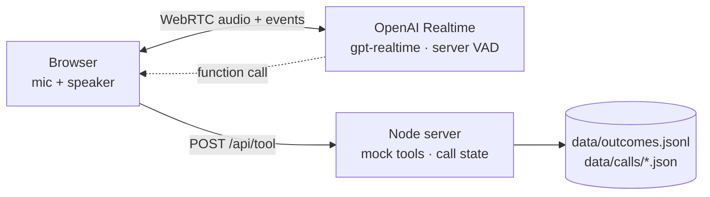

# Lumen EMI Reminder Agent

A voice agent that calls a borrower about an upcoming or overdue EMI, verifies them, reminds them, finds out what they will do, and records a structured outcome.
OpenAI Realtime (speech to speech) over WebRTC in the browser. Plain Node, one dependency.

## Run it

```bash
cp .env.example .env        # add OPENAI_API_KEY
npm install
npm start                   # http://localhost:3000
```

Pick a borrower, press **Start call**, and play the borrower. Use headphones. The operator line under the picker shows the DOB and last four digits to verify with.
Needs Node 22+ and Chrome or Safari.

| Command | What it does |
|---|---|
| `npm start` | Call page on :3000, how-it-works on `/how-it-works` |
| `npm run eval` | 18 scenarios × 3 runs, writes `results/<run>/report.md` |
| `npm run eval -- --only hardship_hindi,family_member --repeats 5` | A subset |
| `npm test` | Unit tests: spoken numbers and dates, verification gate, outcome record, scoring rules |

## How it works



| Step | What happens |
|---|---|
| Greet | "Hi, this is Asha calling from Lumen Finance. Am I speaking with Rahul Sharma?" Nothing about a loan. |
| Verify | DOB or last four digits → `verify_identity`. Three misses locks it. |
| Remind | The tool returns ready-to-say phrases: "twelve thousand five hundred rupees, due this Friday, the twenty-seventh". |
| Respond | Pay on time, paid, later date, hardship, dispute, wrong person, callback, stop, off topic, language switch. |
| Close | Goodbye → `record_outcome` → `end_call`. If the caller hangs up first, the server records `no_resolution`. |

Open `/how-it-works` for the visual version.

## Key decisions

| Decision | Why |
|---|---|
| **Speech to speech (Realtime), not STT → LLM → TTS** | One hop, so lower latency. Built-in barge-in and Hindi. Cost: less control over each stage and the voice. |
| **Loan details are not in the prompt** | The model cannot leak what it does not have. `verify_identity` returns them only on a match. |
| **Tools return spoken phrases, not numbers** | "one lakh twenty-five thousand rupees" is said right every time. No digit reading. |
| **Outcome record built from call state** | `verified` and `payment_link_sent` come from what tools did, not what the model claims. Hardship and disputes always escalate (code backstop, counted in evals). |
| **Silence and slow tools handled in the browser** | 7 s quiet → "Can you hear me?"; second time → close. Tool still running after 1.5 s with nobody speaking → "Just a second, it's going through." |
| **Latency measured from audio, not events** | Mic level drops → speaker level rises. What the caller actually waits. |
| **Evals drive the same agent in text mode** | Same model, prompt and tools. Catches logic and guardrail failures cheaply. It cannot see audio issues; the report says so. |

## Docs

| Doc | Contents |
|---|---|
| How it works (in the app, `/how-it-works`) | Call flow, architecture, guardrails, latency, eval loop |
| [Design](docs/DESIGN.md) | Conversation structure, prompt, tools, guardrails |
| [Results](docs/RESULTS.md) | Eval results, real failures found, what changed |
| [Limits](docs/LIMITS.md) | What this does not do |

## Repo layout

```
src/agent.js        prompt, tool schemas, tool handlers, outcome record
src/spoken.js       amounts and dates in spoken English and Hindi
src/realtime.js     Realtime session config + text-mode client for evals
src/server.js       call page, session keys, tools, call logs
public/             call page, how-it-works page
data/borrowers.json 8 mock borrowers (due dates are relative to today)
evals/              scenarios.json, run.js (runner + judge + report), score.js (rules)
results/            one folder per eval run
```
