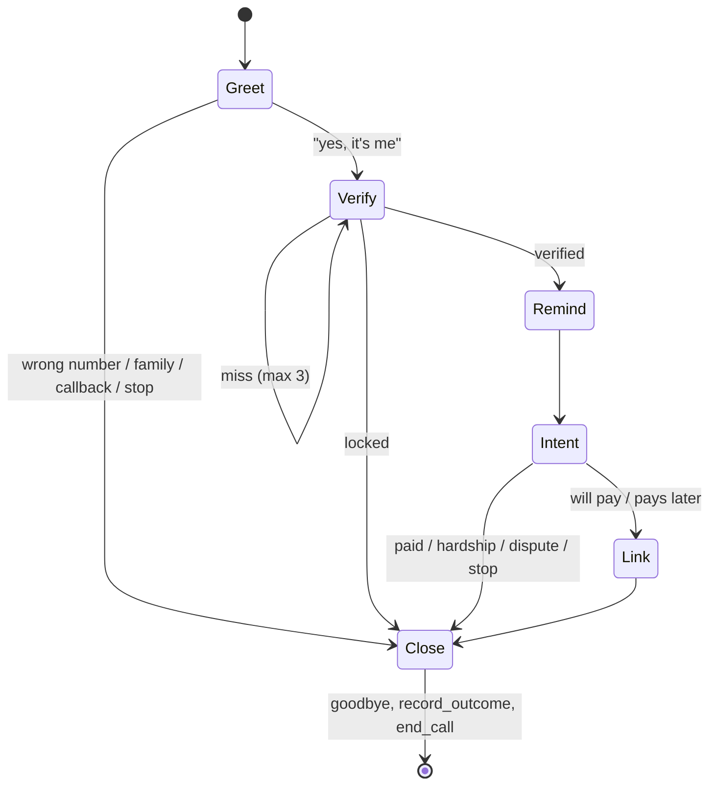

# Design

## The goal

A reminder call that sounds like a capable, polite person: short turns, amounts said naturally, no dead air, and no loan detail to anyone who has not verified.

## Stack and trade-offs

| Choice | Why | Trade-off seen |
|---|---|---|
| OpenAI `gpt-realtime`, WebRTC from the browser | Speech to speech in one hop. Barge-in, VAD and Hindi built in. Browser talks to OpenAI directly with a 10-minute key, so audio never passes our server. | Voice and pacing are less tunable than a separate TTS. The model's text and audio can differ slightly. |
| Server VAD, 500 ms silence | Predictable end of turn, easy to measure. | Can cut in when someone pauses mid-number ("one nine... nine zero"). `TURN_DETECTION=semantic` waits for a complete thought, but adds variable delay. |
| `marin` voice | Clear, warm, handles Indian English names and Hindi. | — |
| Plain Node, `ws` only | Small. Easy to read in one sitting. | No types, no framework. |

## Conversation structure

The model drives the conversation. Code owns the facts and the gates.



### Prompt (`src/agent.js` → `instructions()`)

Seven short sections: call flow, situations (one line each), language, how you speak, limits, and a 21-day calendar so "next Friday" maps to a real date.
The prompt has the borrower's name and preferred language only.

### Tools

| Tool | Does | Guard in code |
|---|---|---|
| `verify_identity` | DOB or last four digits against the file | Returns account facts only on a match. Three misses locks the call. |
| `send_payment_link` | Mock, 2.5 s delay. B006 fails on the first try. | Refuses if not verified. |
| `record_outcome` | Writes the outcome record | Valid outcome enum. Promise date must be YYYY-MM-DD and not past. `verified` and `payment_link_sent` come from state. Hardship and dispute force `escalate_to_human`. |
| `end_call` | Hangs up after the goodbye finishes playing | — |

### Outcome record

```json
{ "borrower_id": "B003", "verified": true, "outcome": "promise_to_pay", "promise_to_pay_date": "2026-11-27",
  "callback_time": null, "payment_link_sent": true, "escalate_to_human": false, "escalate_set_by_model": false,
  "language": "en", "notes": "Will pay Friday after salary. Link sent by SMS." }
```

Outcomes: `will_pay_on_time`, `paid_already`, `promise_to_pay`, `hardship`, `dispute`, `wrong_number`, `third_party`, `callback_requested`, `refused_to_talk`, `verification_failed`, `no_resolution`.

## Conversation quality

| Area | How |
|---|---|
| Latency | Server VAD 500 ms. Tool calls start on `response.output_item.done`, before the response finishes. Prompt keeps first sentences short. Measured in the browser: caller's last audible sound → agent's first audible sound. |
| Barge-in | `interrupt_response: true`. Realtime cancels the reply and truncates what the model thinks it said, so the next reply answers the interruption. Logged per call. |
| Silence | 7 s after the agent stops: "Can you hear me?". Second time: close politely as `no_resolution`. |
| Speaking style | Tools return spoken phrases in English and Hindi (`src/spoken.js`, Indian lakh system). Prompt bans digits and symbols. Eval counts any that slip through. |
| Dead air on tools | Agent says "Sure, sending it now" before the call. If a tool is still running after 1.5 s and nobody is speaking, the browser asks for a one-line filler. |
| Tone | Firm on amount and date, no apology for calling. Hardship: slow down, acknowledge, no push. Irritated: calm, brief, no lecture. |
| Recovery | Unclear speech: ask again, never guess digits. Tool failure: apologise once, retry once, then point to the app. |
| Language | Starts in the preferred language. Switches when the caller does. Hindi phrases come from the tool. |

## Guardrail choices

| Rule | Choice made |
|---|---|
| Disclosure | Before verification the agent says only "a personal matter". The words loan, EMI, amount and type count as disclosure in the eval. Strict on purpose. |
| Family members | Never confirm a loan exists, even to a spouse who "handles the finances". Ask when the borrower is free. |
| Consequences | No mention of fees, credit score, legal action or visits. "A colleague can explain." These are real in lending, but an automated call that gets them wrong does harm. |
| Waivers | "I can't promise that, but I can have a colleague call you about it." |
| AI disclosure | If asked, the agent says it is Lumen Finance's automated assistant. |
| Stop | Ends at once, records `refused_to_talk` so the team can honour it. |
