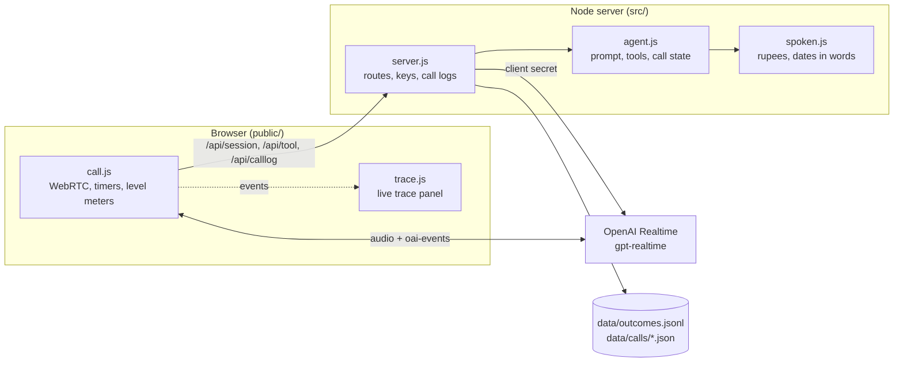
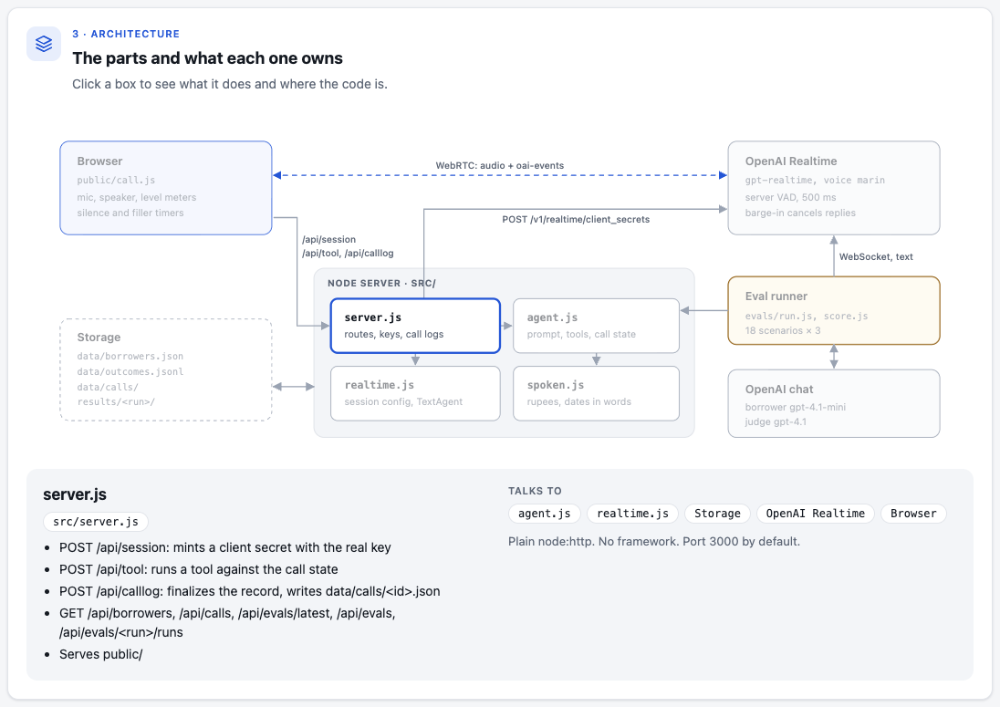
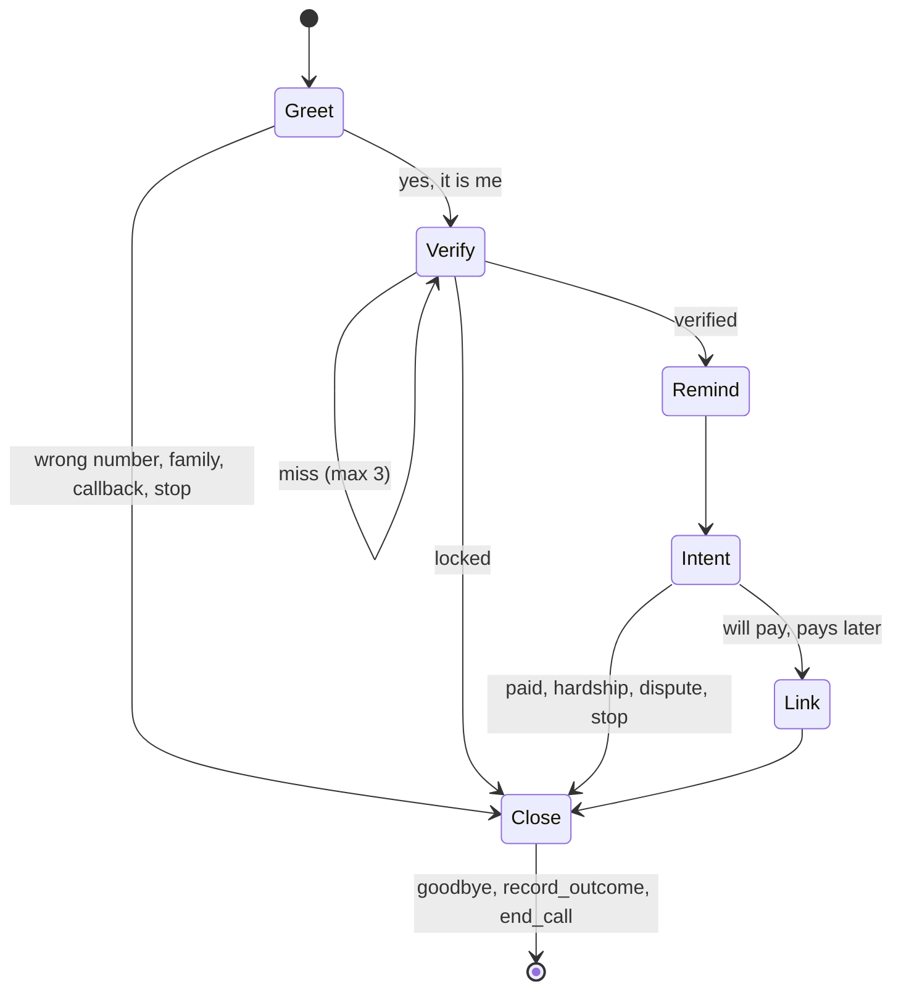
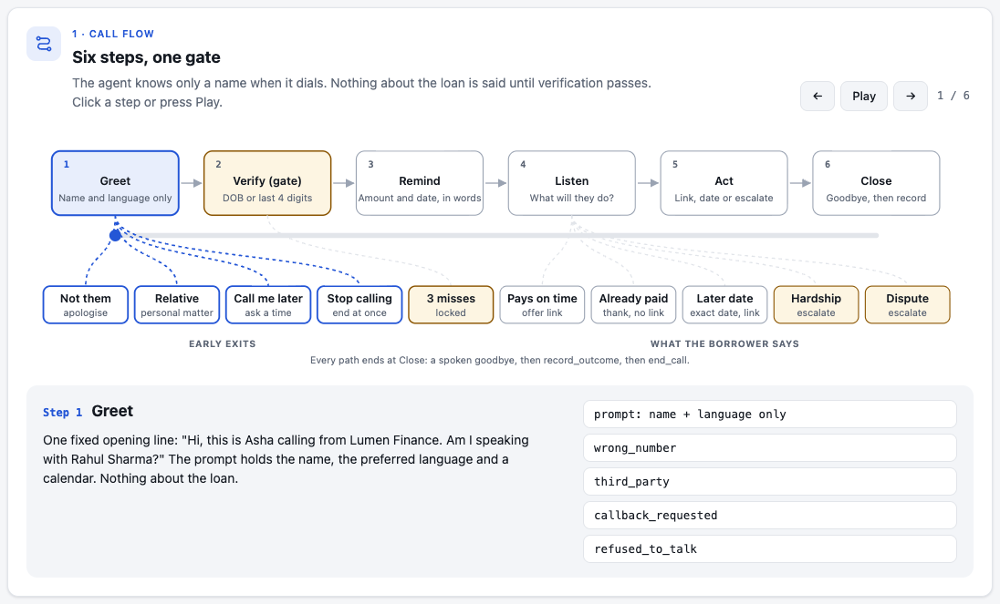
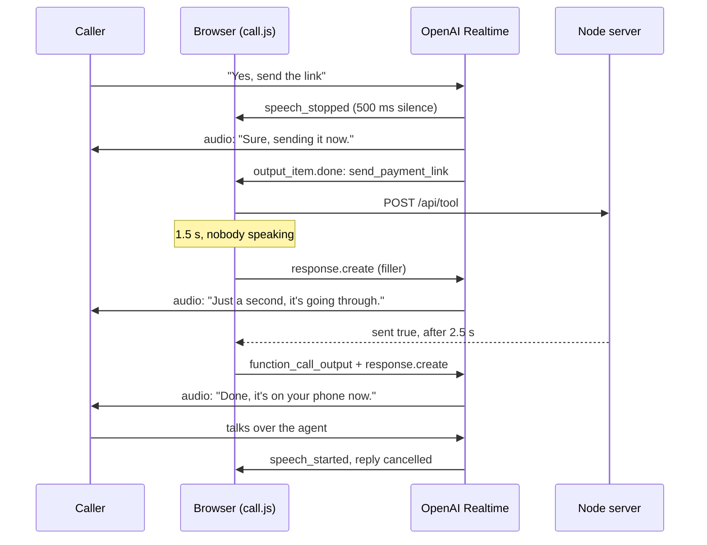
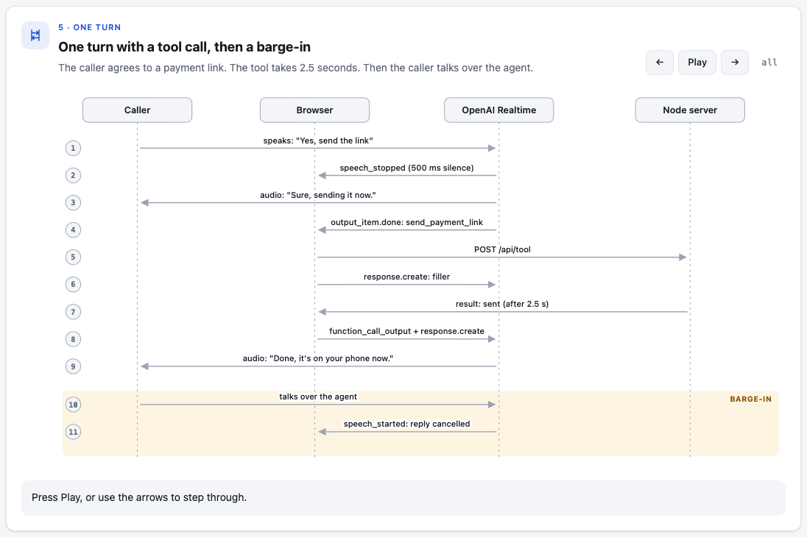
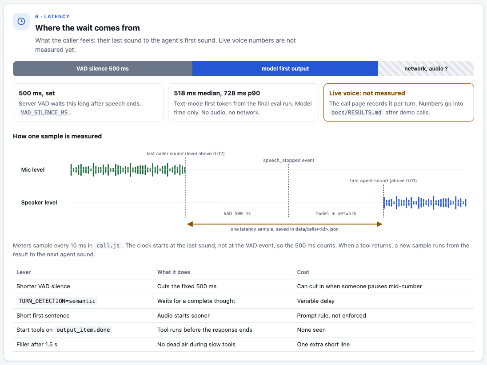

# Design

> **Goal:** a reminder call that sounds like a capable, polite person. Short turns, amounts said naturally, no dead air, and no loan detail to anyone who has not verified.

**The model drives the conversation. Code owns the facts and the gates.**

| Section | |
|---|---|
| [Stack and trade-offs](#stack-and-trade-offs) | Why Realtime speech to speech, VAD, voice |
| [Architecture](#architecture) | What runs where |
| [Conversation structure](#conversation-structure) | Call states, prompt, tools, outcome record |
| [A live turn](#a-live-turn-tool-call-filler-barge-in) | Sequence with a slow tool and a barge-in |
| [Conversation quality](#conversation-quality) | Latency, barge-in, silence, style, recovery |
| [Guardrails](#guardrail-choices) | Disclosure, family, consequences, stop |

## Stack and trade-offs

| Choice | Why | Trade-off seen |
|---|---|---|
| OpenAI `gpt-realtime`, WebRTC from the browser | Speech to speech in one hop. Barge-in, VAD and Hindi built in. Browser talks to OpenAI directly with a 10-minute client secret, so audio never passes our server. | Voice and pacing are less tunable than a separate TTS. The model's text and audio can differ slightly. |
| Server VAD, 500 ms silence | Predictable end of turn, easy to measure. | Can cut in when someone pauses mid-number ("one nine... nine zero"). `TURN_DETECTION=semantic` waits for a complete thought, but adds variable delay. |
| `gpt-4o-mini-transcribe` with a prompt hint | The hint says: Indian English or Hindi, Hindi in Devanagari, names, dates and digits. | Transcripts are for logs and the trace. The model hears the audio itself. |
| `marin` voice | Clear, warm, handles Indian English names and Hindi. | Not tuned per language. |
| Plain Node, `ws` only | Small. Easy to read in one sitting. | No types, no framework. |

<details>
<summary>Session config (from <code>src/realtime.js</code>)</summary>

| Setting | Value | Override |
|---|---|---|
| Model | `gpt-realtime` | `REALTIME_MODEL` |
| Voice | `marin` | `VOICE` |
| Turn detection | `server_vad`, threshold 0.55, prefix padding 300 ms, silence 500 ms, `interrupt_response: true` | `VAD_SILENCE_MS`, `TURN_DETECTION=semantic` |
| Noise reduction | `near_field` | |
| Transcription | `gpt-4o-mini-transcribe` with a prompt hint | |
| Silence nudge | 7000 ms, two nudges, then close | `SILENCE_MS` |
| Mock link delay | 2500 ms live, 300 ms in evals | `LUMEN_TOOL_DELAY_MS` |

</details>

## Architecture





| Route | Does |
|---|---|
| `GET /api/borrowers` | Borrower list for the picker |
| `POST /api/session` | Creates call state, mints a client secret with the real key |
| `POST /api/tool` | Runs one tool against the call state |
| `POST /api/calllog` | Final record, writes `data/calls/<id>.json` |
| `GET /api/calls`, `GET /api/evals/latest` | Recent calls and the latest eval on the call page |
| `GET /api/evals`, `GET /api/evals/<run>/runs` | Eval run summaries and per-call results for `/evals` |

## Conversation structure





### Prompt (`src/agent.js` → `instructions()`)

Seven short sections: call flow, situations (one line each), language, how you speak, limits, and a 21-day calendar so "next Friday" maps to a real date.
The prompt has the borrower's name and preferred language only. No amount, no loan type, no due date.

### Tools

| Tool | Does | Guard in code |
|---|---|---|
| `verify_identity` | DOB or last four digits against the file | Returns account facts only on a match. Three misses lock the call. |
| `send_payment_link` | Mock, 2.5 s delay. B006 fails on the first try. | Refuses if not verified. |
| `record_outcome` | Writes the outcome record | Valid outcome enum. Promise date must be YYYY-MM-DD and not past. `verified` and `payment_link_sent` come from state. Hardship and dispute force `escalate_to_human`. |
| `end_call` | Hangs up after the goodbye finishes playing | Browser asks for a goodbye first if the caller spoke last |

### Outcome record

```json
{ "borrower_id": "B003", "verified": true, "outcome": "promise_to_pay", "promise_to_pay_date": "2026-11-27",
  "callback_time": null, "payment_link_sent": true, "escalate_to_human": false, "escalate_set_by_model": false,
  "language": "en", "notes": "Will pay Friday after salary. Link sent by SMS." }
```

<details>
<summary>The 11 outcomes</summary>

| Outcome | When |
|---|---|
| `will_pay_on_time` | Verified, will pay by the due date |
| `paid_already` | Says they already paid |
| `promise_to_pay` | Gives a specific later date |
| `hardship` | Cannot pay. Always escalated. |
| `dispute` | Disputes the amount or the loan. Always escalated. |
| `wrong_number` | Not the borrower, does not know them |
| `third_party` | Someone who knows the borrower, such as a relative |
| `callback_requested` | Asks to be called at another time |
| `refused_to_talk` | Asks to stop. Recorded so the team can honour it. |
| `verification_failed` | Three misses |
| `no_resolution` | Silence, or the caller hung up first |

</details>

## A live turn: tool call, filler, barge-in

The caller agrees to a payment link. The tool takes 2.5 s. Then the caller talks over the agent.





## Conversation quality

| Area | How |
|---|---|
| Latency | Server VAD 500 ms. Tool calls start on `response.output_item.done`, before the response finishes. Prompt keeps first sentences short. |
| Latency measurement | In the browser, from audio levels every 10 ms: caller's last sound above 0.02 to the agent's first sound above 0.01. A sample is taken on the rising edge only, when the agent goes from quiet to audible. |
| Barge-in | `interrupt_response: true`. Realtime cancels the reply and truncates what the model thinks it said, so the next reply answers the interruption. Logged per call. |
| Silence | 7 s after the agent stops: "Can you hear me?". Second time: close politely as `no_resolution`. |
| Speaking style | Tools return spoken phrases in English and Hindi (`src/spoken.js`, Indian lakh system). Prompt bans digits and symbols. Eval counts any that slip through. |
| Dead air on tools | Agent says "Sure, sending it now" before the call. If a tool is still running after 1.5 s and nobody is speaking, the browser asks for a one-line filler. |
| Silent hang-up | If `end_call` arrives right after the caller spoke, the browser asks for a one-sentence goodbye first. |
| Tone | Firm on amount and date, no apology for calling. Hardship: slow down, acknowledge, no push. Irritated: calm, brief, no lecture. |
| Recovery | Unclear speech: ask again, never guess digits. Tool failure: apologise once, retry once, then point to the app. |
| Language | Starts in the preferred language. Switches when the caller does. Hindi phrases come from the tool. |
| Live trace | The call page shows every model response, tool call, caller turn and error as it happens, with timings. |



## Guardrail choices

Three layers: code enforces, the prompt asks, evals check.

| Rule | Choice made | Enforced by |
|---|---|---|
| Disclosure | Before verification the agent says only "a personal matter". The words loan, EMI, amount and type count as disclosure in the eval. Strict on purpose. | Code (facts arrive only after a match) + prompt + eval rule and judge |
| Family members | Never confirm a loan exists, even to a spouse who "handles the finances". Ask when the borrower is free. | Prompt + eval |
| Consequences | No mention of fees, credit score, legal action or visits. "A colleague can explain." These are real in lending, but an automated call that gets them wrong does harm. | Prompt + judge flag |
| Waivers | "I can't promise that, but I can have a colleague call you about it." | Prompt + judge flag |
| Escalation | Hardship and dispute always go to a human. | Code backstop, counted in evals |
| AI disclosure | If asked, the agent says it is Lumen Finance's automated assistant. | Prompt |
| Stop | Ends at once, records `refused_to_talk` so the team can honour it. | Prompt + eval |
